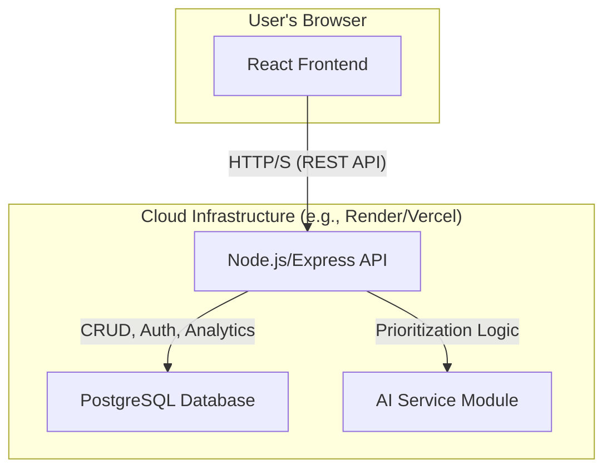

# Architecture: AI Task Manager

**Owner:** <name or team>
**Last Updated:** 2025-12-01
**Version:** 1.0

## Purpose

Single-page summary of system components, responsibilities, and high-level flows for the AI Task Manager v1.0.

## Context

A micro-SaaS task management platform with AI-powered prioritization, a responsive web UI, a RESTful API backend, and lightweight analytics.

## Components

- **Frontend:** React SPA (Client-Side Rendered)
  - Location: `/app/frontend`
  - Stack: React, TypeScript, TailwindCSS
  - State Management: Zustand

- **Backend:** Node.js API
  - Location: `/app/backend`
  - Stack: Node.js, Express, TypeScript
  - ORM: Prisma

- **Database:** PostgreSQL
  - Managed service (e.g., on Render, Railway) or self-hosted.

- **AI Layer:** Abstracted Service Module
  - Pluggable interface for different AI models (e.g., local LLM, cloud APIs).
  - Handles the logic for the `/ai/prioritize` endpoint.

## High-level Diagram

